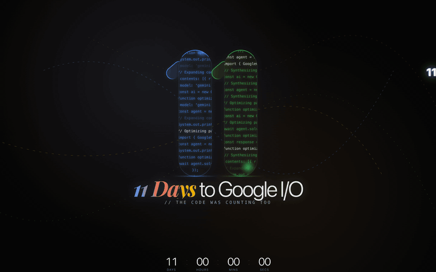
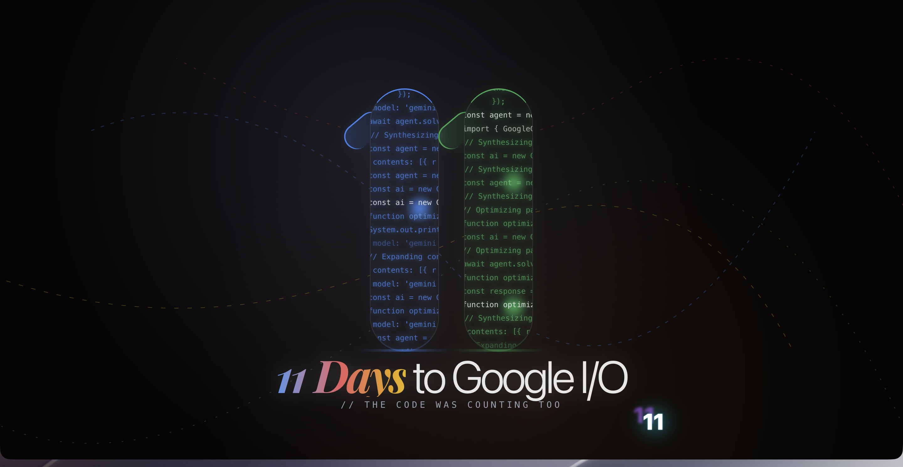

# 11 Days to Google I/O





Two glowing capsule pillars filled with scrolling code form the number **11**. A spring-physics cursor trail follows your mouse as three stacked "11" glyphs. The background pulses with an animated plasma aura cycling through Google's brand colors.

Built for the 11-day countdown to Google I/O 2026 (May 20, 2026).

## Quick Start

```bash
git clone https://github.com/AndrewVoirol/google-io-2026-countdown.git
cd google-io-2026-countdown
npm install
npm run dev
```

## How It Works

Move your mouse. Watch the "11" cursor trail with three layers of spring physics — each one lagging a little more than the last. Hover over the pillars to see the code lines glitch and the orbs brighten. That's it. It's a vibe piece.

Under the hood: two `<Pillar>` components scroll randomized Gemini API code snippets vertically, each with its own speed. The serif/beak on each pillar is a rotated rounded div. Orbs float upward inside the capsules on infinite linear loops. The plasma background keyframes between radial gradients at Google's four brand colors.

## Tech Stack

| Layer | Tech |
|---|---|
| Framework | React 19 + TypeScript |
| Build | Vite 6 |
| Styling | Tailwind CSS v4 |
| Animation | motion/react (Framer Motion successor) |
| Typography | Inter + Playfair Display (Google Fonts) |

## Features

- **Code waterfall pillars** — scrolling Gemini API snippets inside glowing capsule shapes
- **Spring-physics cursor trail** — three layered "11" glyphs with increasing damping
- **Plasma aura background** — radial gradients cycling through Google Blue, Red, Yellow, Green
- **Hover effects** — pillar scale, code glitch, floating orbs
- **Touch-aware** — cursor trail auto-hides on touch devices, restores default pointer
- **Zero config** — no API keys, no backend, no env vars

## License

Apache-2.0
